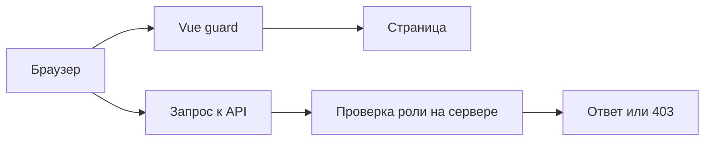
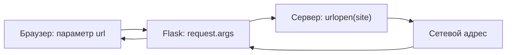

# Партия 01: 100 новых репозиториев

Репозитории 1–100 из списка [targets.json](../../../datasets/diverse/2026-11-15/targets.json). Разбор выполнен по закреплённым исходникам; приложения не запускались.

## 1. Закомментированный guard: фронтенд и права на API — разные проверки

**TP — подтверждённый сигнал сопровождения кода.** Правило: `commented-code`.

Исходник: [paynezhuang/panis-admin — src/router/guard/route.ts:55](https://github.com/paynezhuang/panis-admin/blob/948ba56578827c76d0b6ae731d98e1225e4c642e/src/router/guard/route.ts#L55). SHA: `948ba56578827c76d0b6ae731d98e1225e4c642e`.

### Что происходит

В Vue guard видны рабочие проверки входа, затем отключённый блок перехода на 403 при отсутствии разрешения. Сканер верно нашёл оставленный комментариями код.

### Что можно утверждать

Подтверждён только дефект сопровождения. По этому файлу нельзя установить, что сервер разрешает запрещённые запросы.

### Что с этим делать

Уточнить требуемое поведение маршрутов и удалить устаревший блок либо восстановить нужную логику. Отдельно проверять авторизацию каждого защищённого API на сервере.

## 2. SSRF: браузер выбирает адрес, а запрос выполняет сервер

**TP — подтверждённый сигнал.** Правило: `insecure-ssrf`.

Исходник: [peachycloudsecurity/very-vulnerable-serverless — app.py:46](https://github.com/peachycloudsecurity/very-vulnerable-serverless/blob/cb0d864ab007632f20f41736b1cddbba2a1d4bdc/app.py#L46). SHA: `cb0d864ab007632f20f41736b1cddbba2a1d4bdc`.

### Что происходит

Браузер передаёт url → Flask читает request.args → urlopen(site) выполняет запрос от имени сервера → ответ возвращается клиенту. Эта цепочка видна в исходнике учебного приложения.

### Что можно утверждать

Обработчик должен быть доступен клиенту; результат зависит от сетевых разрешений среды. Код не доказывает доступ к конкретному внутреннему сервису или облачным секретам.

### Что с этим делать

Для рабочей системы задают разрешённые назначения, проверяют схему и адрес, учитывают перенаправления и ограничения исходящей сети. Учебное приложение намеренно оставляет эту ошибку.

