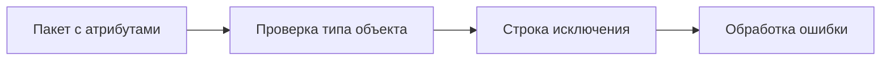
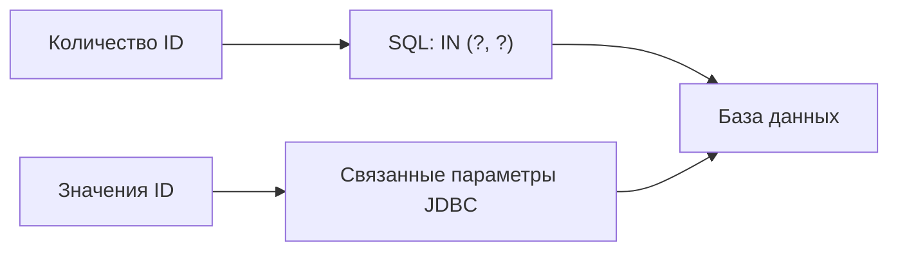

# Партия 02: 100 новых репозиториев

Репозитории 101–200 из списка [targets.json](../../../datasets/diverse/2026-11-15/targets.json). Разбор выполнен по закреплённым исходникам; приложения не запускались.

## 1. Обычная строка ошибки похожа на SQL только для регулярного выражения

**FP — ложное срабатывание.** Правило: `insecure-sql-interpolated`.

Исходник: [CreativeMD/LittleTiles — src/main/java/team/creative/littletiles/client/player/LittleClientPlayerHandler.java:1089](https://github.com/CreativeMD/LittleTiles/blob/bba2a1fa03985314e8d18fcdd7eb02f4ca13569a/src/main/java/team/creative/littletiles/client/player/LittleClientPlayerHandler.java#L1089). SHA: `bba2a1fa03985314e8d18fcdd7eb02f4ca13569a`.

### Что происходит

Сетевой пакет обновляет свойства игрового объекта. При неподходящем типе объекта код создаёт текст исключения со словом update. Запроса к базе в этой строке нет.

### Что можно утверждать

Это FP по классу SQL-инъекции. Наличие слова update и конкатенации не доказывает выполнение SQL; оценка других свойств обработчика здесь не проводилась.

### Что с этим делать

Сначала ищем реальный вызов драйвера БД, затем прослеживаем, какие части запроса зависят от входных данных. Для этой строки SQL-исправление не требуется.

## 2. Конкатенация SQL бывает безопасной: плейсхолдеры и связанные параметры

**FP — ложное срабатывание.** Правило: `insecure-sql-interpolated`.

Исходник: [LingFrame/LingFrame — lingframe-examples/lingframe-example-ling-user-canary/src/main/java/com/lingframe/example/user/canary/service/impl/UserServiceImpl.java:146](https://github.com/LingFrame/LingFrame/blob/f8df67fe3a86897620e56d15946cbf6e9bcdd655/lingframe-examples/lingframe-example-ling-user-canary/src/main/java/com/lingframe/example/user/canary/service/impl/UserServiceImpl.java#L146). SHA: `f8df67fe3a86897620e56d15946cbf6e9bcdd655`.

### Что происходит

Цикл строит только строку из вопросительных знаков и запятых. Список userIds передаётся третьим аргументом jdbcTemplate.query, отдельно от SQL-шаблона.

### Что можно утверждать

По этому месту SQL-инъекция не подтверждается: пользовательские значения не становятся текстом SQL. Права на получение конкретных пользователей требуют отдельной проверки.

### Что с этим делать

Так и строят список IN (?, ?): шаблон отдельно, значения отдельно. Если переменными становятся имена таблиц или столбцов, для них нужны отдельные ограничения.

