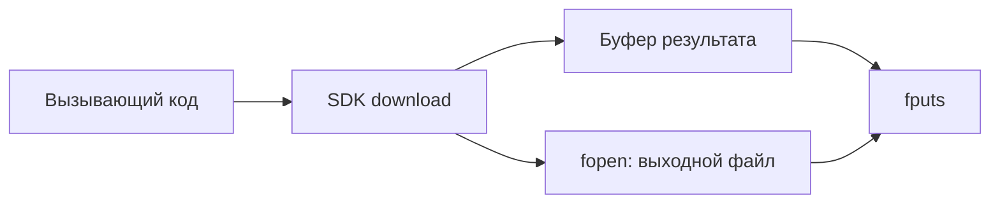
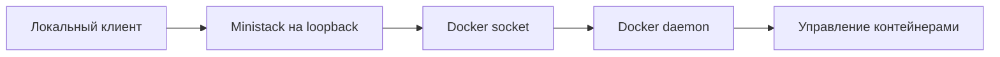

# Партия 03: 100 новых репозиториев

Репозитории 201–300 из списка [targets.json](../../../datasets/diverse/2026-11-15/targets.json). Разбор выполнен по закреплённым исходникам; приложения не запускались.

## 1. Локальная запись файла и HTTP-запрос — разные действия

**FP — ложное срабатывание.** Правило: `insecure-ssrf`.

Исходник: [ilovepdf/ilovepdf-php — src/Task.php:477](https://github.com/ilovepdf/ilovepdf-php/blob/bb23c6095d9327288c2982e36657db9bcfe1ca84/src/Task.php#L477). SHA: `bb23c6095d9327288c2982e36657db9bcfe1ca84`.

### Что происходит

Метод SDK получает результат задачи, строит имя выходного файла и открывает его в режиме w+, после чего записывает буфер через fputs.

### Что можно утверждать

Эта строка относится к выводу файла. Здесь не установлено, что удалённый пользователь заставляет сервер выполнять запрос к выбранному HTTP-адресу. Безопасность всего SDK этим выводом не подтверждается.

### При каких других условиях возник бы риск

Для SSRF нужна другая цепочка: недоверенный URL → сетевой запрос сервера → адрес, к которому пользователь не должен обращаться через этот сервер. Важны источник адреса, разрешённые схемы, перенаправления, DNS и сетевые ограничения. Локальное чтение или запись файла не доказывает такой запрос.

Это учебное изменение условий, а не дополнительная находка в этом репозитории.

### Что с этим делать

В приложении, принимающем путь из запроса, отдельно ограничивают допустимый каталог и протоколы потоковых обёрток. Одна is_dir не заменяет такую проверку.

## 2. Docker socket у локального AWS-эмулятора: проверяем назначение сервиса

**FP — ложное срабатывание.** Правило: `iac-docker-socket`.

Исходник: [seborama/govcr — docker-compose.yaml:19](https://github.com/seborama/govcr/blob/bb8afa156df5e82e4dbb1e8a0bf253550658b678/docker-compose.yaml#L19). SHA: `bb8afa156df5e82e4dbb1e8a0bf253550658b678`.

### Что происходит

Compose объявляет локальные сервисы для разработки. Ministack опубликован на 127.0.0.1 и получает Docker socket как часть своей работы.

### Что можно утверждать

Сокет даёт сильные полномочия по управлению контейнерами. Здесь он ожидаем для инструмента; эксплуатация через недоверенный вход этим файлом не доказана. Последствия зависят и от конфигурации Docker daemon.

### При каких других условиях возник бы риск

Возможная цепочка риска: компрометация приложения в контейнере → доступ к Docker API через сокет → действия daemon с его правами на хосте. Нужны реальные предпосылки компрометации и доступ к API. Монтирование сокета с :ro само по себе не запрещает изменяющие API-запросы.

Это учебное изменение условий, а не дополнительная находка в этом репозитории.

### Что с этим делать

Разработчик должен понимать границы доверия локального эмулятора. Для публичного сервиса пришлось бы отдельно обосновать допустимые операции, доступ к API и изоляцию.

