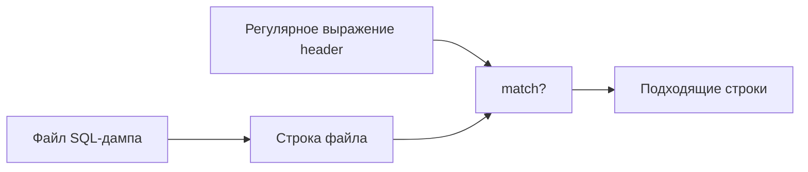
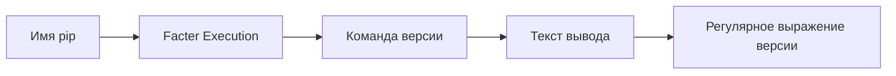

# Партия 04: 100 новых репозиториев

Репозитории 301–400 из списка [targets.json](../../../datasets/diverse/2026-11-15/targets.json). Разбор выполнен по закреплённым исходникам; приложения не запускались.

## 1. Ruby: обратные кавычки внутри регулярного выражения

**FP — ложное срабатывание.** Правило: `insecure-exec-interpolated`.

Исходник: [yohasebe/wp2txt — lib/wp2txt/sql_dump_reader.rb:24](https://github.com/yohasebe/wp2txt/blob/2ebc5f159301f9b62537523ba51f3160a5c11224/lib/wp2txt/sql_dump_reader.rb#L24). SHA: `2ebc5f159301f9b62537523ba51f3160a5c11224`.

### Что происходит

Метод читает строки SQL-дампа и сравнивает их с header.match?. Обратные кавычки в header обозначают символы имени таблицы в данных, а не запуск команды.

### Что можно утверждать

Подтверждён FP командной инъекции. В Ruby роль символа зависит от окружающего синтаксиса; поиск одних кавычек теряет этот контекст.

### Что с этим делать

Проверять, доходит ли значение до настоящего запуска процесса. При улучшении анализатора важно отдельно разбирать выражения интерполяции, а не просто исключать все регулярные выражения.

## 2. Метод execute может запускать команду, а не SQL

**FP — ложное срабатывание.** Правило: `insecure-sql-interpolated`.

Исходник: [voxpupuli/puppet-python — lib/facter/pip_version.rb:7](https://github.com/voxpupuli/puppet-python/blob/b8a263ad87c8cb437f67904434aa931834e99020/lib/facter/pip_version.rb#L7). SHA: `b8a263ad87c8cb437f67904434aa931834e99020`.

### Что происходит

Facter вызывает pip с аргументом --version и извлекает номер версии регулярным выражением. В показанных вызовах передаются имена pip, pip2 и pip3.

### Что можно утверждать

Это FP по SQL-инъекции. Оценка запуска внешних программ — отдельный вопрос; одинаковое имя execute не делает API интерфейсом базы данных.

### Что с этим делать

При проверке прослеживать тип объекта и назначение вызываемой библиотеки. Для SQL сначала нужен реальный путь к драйверу БД.

