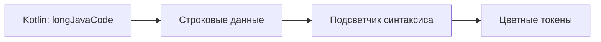
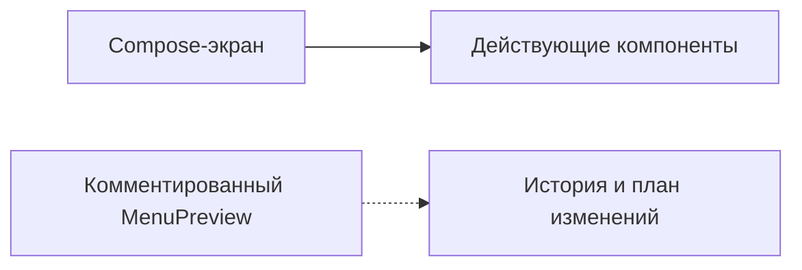

# Партия 05: 100 новых репозиториев

Репозитории 401–500 из списка [targets.json](../../../datasets/diverse/2026-11-15/targets.json). Разбор выполнен по закреплённым исходникам; приложения не запускались.

## 1. Пример кода в строке не выполняется как Java

**FP — ложное срабатывание.** Правило: `insecure-java-deserialization`.

Исходник: [SnipMeDev/Highlights — src/commonTest/kotlin/dev/snipme/highlights/internal/CodeSamples.kt:510](https://github.com/SnipMeDev/Highlights/blob/600927f48737ac4f1504c31ad59fa9b88eee6947/src/commonTest/kotlin/dev/snipme/highlights/internal/CodeSamples.kt#L510). SHA: `600927f48737ac4f1504c31ad59fa9b88eee6947`.

### Что происходит

Слово readObject находится в тестовых данных подсветчика синтаксиса. Весь Java-пример хранится в Kotlin-переменной longJavaCode между тройными кавычками на строках 3 и 1314.

### Что можно утверждать

Подтверждён FP десериализации. Чтобы строковый образец начал исполняться, нужен отдельный интерпретатор или компилятор; такого перехода эта находка не показывает.

### Что с этим делать

Различать язык файла, строки с образцами и реально выполняемые вызовы. Это особенно важно для редакторов, документации и security-инструментов.

## 2. Закомментированный экран: что действительно нашёл сканер

**TP — подтверждённый сигнал сопровождения кода.** Правило: `commented-code`.

Исходник: [chayanforyou/QuickBall — app/src/main/java/io/github/chayanforyou/quickball/ui/screens/shortcut/ShortcutMenuScreen.kt:143](https://github.com/chayanforyou/QuickBall/blob/97b59520b54ad9dceedd9386ee3019c658df03d9/app/src/main/java/io/github/chayanforyou/quickball/ui/screens/shortcut/ShortcutMenuScreen.kt#L143). SHA: `97b59520b54ad9dceedd9386ee3019c658df03d9`.

### Что происходит

Внутри рабочего Compose-экрана оставлен отключённый блок Card с MenuPreview. После него расположен действующий блок карточки ярлыков.

### Что можно утверждать

Подтверждён оставленный комментариями код. Исполняться этот блок не может; из него не следует нарушение безопасности.

### Что с этим делать

Удалить устаревший вариант или вынести задумку в задачу с описанием требуемого поведения. История Git сохранит предыдущую реализацию.

