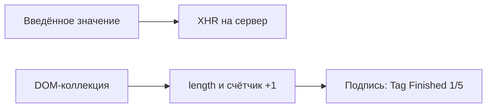
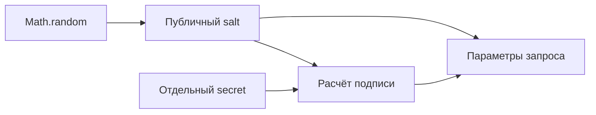

# Партия 06: 100 новых репозиториев

Репозитории 501–600 из списка [targets.json](../../../datasets/diverse/2026-11-15/targets.json). Разбор выполнен по закреплённым исходникам; приложения не запускались.

## 1. innerHTML со счётчиками: проверяем именно подставляемые значения

**FP — ложное срабатывание.** Правило: `insecure-innerhtml-dynamic`.

Исходник: [expertiza/expertiza — app/assets/javascripts/answer_tags.js:26](https://github.com/expertiza/expertiza/blob/c6c4fd9df212654b94bb06f131a49679ec14c7b0/app/assets/javascripts/answer_tags.js#L26). SHA: `c6c4fd9df212654b94bb06f131a49679ec14c7b0`.

### Что происходит

Пользовательское значение отправляется в XHR, а в HTML попадает отдельная пара счётчиков. В проверенном helper countTotalTags возвращает length коллекции, countTaggedTags увеличивает число от нуля.

Дополнительно проверено: [исходник](https://github.com/expertiza/expertiza/blob/c6c4fd9df212654b94bb06f131a49679ec14c7b0/app/assets/javascripts/view_my_scores_helper.js#L6)

### Что можно утверждать

Это FP XSS в рассмотренной строке, несмотря на high у сканера. Данные влияют на количество, но произвольный HTML-текст из них сюда не попадает.

### При каких других условиях возник бы риск

Если бы непроверенный текст напрямую подставлялся в HTML, цепочка могла бы быть такой: внешний ввод → строка разметки → HTML-парсер браузера → действия в контексте страницы. Для риска нужны данные, способные изменить разметку, и отсутствие подходящего экранирования. В проверенной строке показанное преобразование разрывает именно этот путь.

Это учебное изменение условий, а не дополнительная находка в этом репозитории.

### Что с этим делать

Для обычной подписи textContent выражает намерение яснее. При анализе XSS прослеживают конкретные подстановки; само наличие пользовательского ввода в файле недостаточно.

## 2. Публичный salt запроса и секрет аутентификации

**FP — ложное срабатывание.** Правило: `insecure-random-for-secret`.

Исходник: [IFreeOvO/i18n-cli — packages/translate-utils/src/baidu.ts:19](https://github.com/IFreeOvO/i18n-cli/blob/9ce97bdd51ad5e9a7611ed51a2c01195ca059758/packages/translate-utils/src/baidu.ts#L19). SHA: `9ce97bdd51ad5e9a7611ed51a2c01195ca059758`.

### Что происходит

Клиент создаёт salt, добавляет его к параметрам URL и использует вместе с переданным secret при расчёте подписи. Значение salt видно получателю запроса.

### Что можно утверждать

Это FP правила про генерацию секретов. По имени переменной salt нельзя заключить, что результат Math.random должен быть секретом. Безопасность всего протокола этим разбором не оценивается.

### При каких других условиях возник бы риск

Если бы Math.random создавал пароль или сессионный секрет, предсказуемость генератора могла бы ослабить защиту от подбора. Для публичного nonce проверяются требования конкретного протокола: случайность, уникальность и секретность — разные свойства.

Это учебное изменение условий, а не дополнительная находка в этом репозитории.

### Что с этим делать

Для паролей и сессионных токенов нужны криптографические генераторы. У nonce проверяют требования конкретного протокола; хранение option.secret и подпись — отдельные вопросы.

