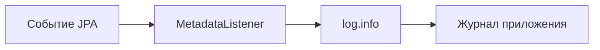
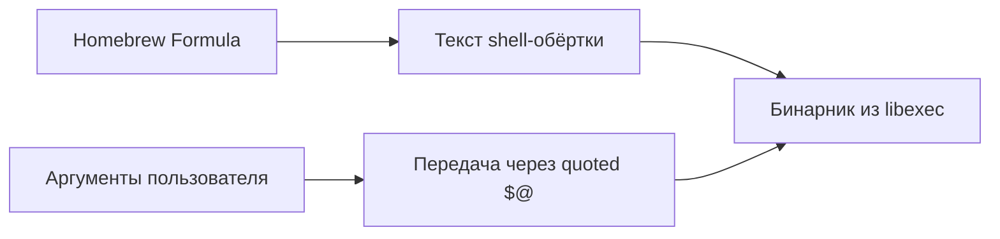

# Партия 07: 100 новых репозиториев

Репозитории 601–700 из списка [targets.json](../../../datasets/diverse/2026-11-15/targets.json). Разбор выполнен по закреплённым исходникам; приложения не запускались.

## 1. Файл связан с базой, а строка пишет в лог

**FP — ложное срабатывание.** Правило: `insecure-sql-interpolated`.

Исходник: [Aiven-Open/klaw — core/src/main/java/io/aiven/klaw/listeners/MetadataListener.java:47](https://github.com/Aiven-Open/klaw/blob/574ceed2aa5a3d45a5cf000c71088cb42c362b93/core/src/main/java/io/aiven/klaw/listeners/MetadataListener.java#L47). SHA: `574ceed2aa5a3d45a5cf000c71088cb42c362b93`.

### Что происходит

JPA вызывает listener перед изменением метаданных. Метод beforeAnyUpdate пишет сообщение через log.info; слова update/delete являются частью текста сообщения.

### Что можно утверждать

Это FP SQL-инъекции в указанном месте. Связь класса с базой не делает каждую его строку SQL-запросом. Содержание журналов и другие методы требуют самостоятельной оценки.

### При каких других условиях возник бы риск

В другой реализации цепочка риска выглядела бы так: браузер → HTTP-параметр → включение значения в структуру SQL на сервере → выполнение изменённого запроса базой. Нужны и внешний источник, и настоящий SQL-приёмник; параметризованные значения должны оставаться данными.

Это учебное изменение условий, а не дополнительная находка в этом репозитории.

### Что с этим делать

Сначала установить назначение конкретного вызова. Для SQLi нужны путь к выполнению запроса и влияние внешних значений на его структуру.

## 2. Скрипт запуска, генерируемый установщиком

**FP — ложное срабатывание.** Правило: `insecure-exec-interpolated`.

Исходник: [lxcshine/zilan — Formula/weknora-lite.rb:72](https://github.com/lxcshine/zilan/blob/3b36977a2b24ae4cb03843cfe76350055c71cc53/Formula/weknora-lite.rb#L72). SHA: `3b36977a2b24ae4cb03843cfe76350055c71cc53`.

### Что происходит

Formula записывает shell-обёртку через heredoc. Путь к бинарному файлу берётся из libexec Homebrew, а аргументы пересылаются как "$@". Строка находится внутри текста будущего скрипта.

Дополнительно проверено: [исходник](https://github.com/lxcshine/zilan/blob/3b36977a2b24ae4cb03843cfe76350055c71cc53/Formula/weknora-lite.rb#L37)

### Что можно утверждать

Это FP по заявленному пути Ruby-командной инъекции. Сам запуск бинарника намерен. Кому разрешено менять локальную конфигурацию и что делает запущенная программа — отдельные вопросы.

### При каких других условиях возник бы риск

Для командной инъекции нужен путь от недоверенного значения к интерпретируемой командной строке: внешний ввод → сборка shell-команды → оболочка → действие с правами процесса. Одноимённый метод объекта не является shell-приёмником; локальный wrapper требует самостоятельной проверки источника команды и аргументов.

Это учебное изменение условий, а не дополнительная находка в этом репозитории.

### Что с этим делать

Различать код установщика и сгенерированный им скрипт, затем проверять источник пути и способ передачи аргументов. Для этой строки источник команды не является HTTP-параметром.

