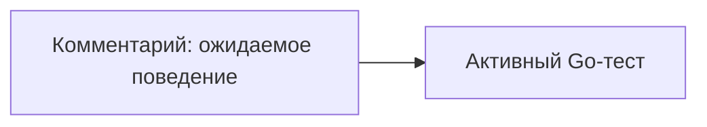
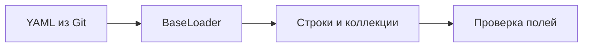

# Партия 08: 100 новых репозиториев

Репозитории 701–800 из списка [targets.json](../../../datasets/diverse/2026-11-15/targets.json). Разбор выполнен по закреплённым исходникам; приложения не запускались.

## 1. Описание сценария теста — не выключенный код

**FP — ложное срабатывание.** Правило: `commented-code`.

Исходник: [tokencanopy/e2a — internal/hitlworker/loopback_screening_test.go:13](https://github.com/tokencanopy/e2a/blob/fd8126e63eef0c27f211be47bc71b352f6b145ea/internal/hitlworker/loopback_screening_test.go#L13). SHA: `fd8126e63eef0c27f211be47bc71b352f6b145ea`.

### Что происходит

Комментарий объясняет две проверки письма: исходящую и входящую. Ниже работает сам тест с настройкой allowlist.

### Что можно утверждать

Слова gate=allowlist и pending_review являются обозначениями настроек в пояснении. Удаление комментария потеряет описание ожидаемого поведения.

### Что с этим делать

Для commented-code нужны признаки синтаксически завершённых инструкций, а не только знаки равенства и имена событий.

## 2. yaml.load: важен выбранный Loader

**FP — ложное срабатывание.** Правило: `insecure-py-yaml-load`.

Исходник: [beyarkay/eskom-calendar — dataset/build.py:119](https://github.com/beyarkay/eskom-calendar/blob/9087a2908d6fb10b0e366be1eb42e921f0d18cdd/dataset/build.py#L119). SHA: `9087a2908d6fb10b0e366be1eb42e921f0d18cdd`.

### Что происходит

Скрипт получает YAML из истории Git и разбирает его через BaseLoader. Затем отдельно проверяет и преобразует записи.

### Что можно утверждать

FP именно выполнения Python-объектов через небезопасный YAML-loader. BaseLoader не включает конструкторы произвольных Python-объектов. Ограничение размера входа — отдельный вопрос.

### Что с этим делать

Различать Loader, UnsafeLoader, SafeLoader и BaseLoader. Нельзя оценивать безопасность только по имени yaml.load.

