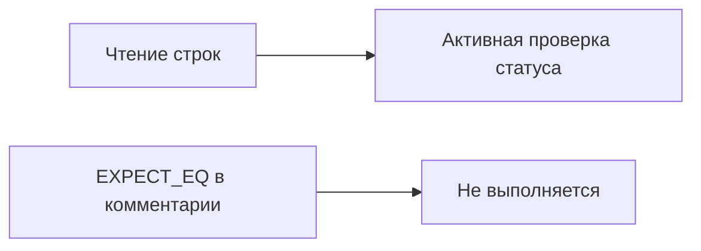
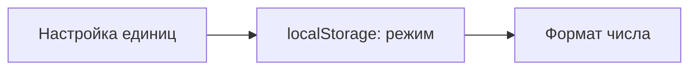

# Партия 09: 100 новых репозиториев

Репозитории 801–900 из списка [targets.json](../../../datasets/diverse/2026-11-15/targets.json). Разбор выполнен по закреплённым исходникам; приложения не запускались.

## 1. Закомментированная проверка теста

**FP — ложное срабатывание.** Правило: `commented-code`.

Исходник: [llnl/axom — src/axom/inlet/tests/inlet_Reader.cpp:180](https://github.com/llnl/axom/blob/bf9c43186c077730da7b4cba7116a12119394579/src/axom/inlet/tests/inlet_Reader.cpp#L180). SHA: `bf9c43186c077730da7b4cba7116a12119394579`.

### Что происходит

Тест читает строковые значения из Lua/YAML. Декларация ожидаемого словаря и EXPECT_EQ оставлены в комментариях.

### Что можно утверждать

FP по критерию рутины: это тестовый сценарий с пояснением различий Lua/YAML. Наличие выключенной проверки само по себе не подтверждает проблему рабочего приложения.

### Что с этим делать

Явно оформить ожидаемые различия парсеров в тесте либо убрать устаревший вариант в пользу истории Git.

## 2. Token может означать единицу подсчёта текста

**FP — ложное срабатывание.** Правило: `insecure-localstorage-secret`.

Исходник: [yuhengqin/Quotern — apps/desktop/src/renderer/lib/utils.ts:61](https://github.com/yuhengqin/Quotern/blob/b6c681872df0caaf9988ff3466e91ca4f8291c38/apps/desktop/src/renderer/lib/utils.ts#L61). SHA: `b6c681872df0caaf9988ff3466e91ca4f8291c38`.

### Что происходит

setTokenUnitMode сохраняет способ отображать количество LLM-токенов. Чтение возвращает international или localized.

### Что можно утверждать

FP хранения секрета. Эти значения выбирают подписи чисел в интерфейсе и не подтверждают личность пользователя.

### При каких других условиях возник бы риск

Если бы сохранённое значение было действующим сессионным секретом, выполняющийся на том же origin сторонний или внедрённый скрипт мог бы прочитать его и использовать в пределах его прав и срока действия. Здесь сохранена настройка отображения, а не такой секрет.

Это учебное изменение условий, а не дополнительная находка в этом репозитории.

### Что с этим делать

Проверять семантику значения: настройки интерфейса можно хранить в localStorage. Сессионные секреты требуют отдельной оценки.

