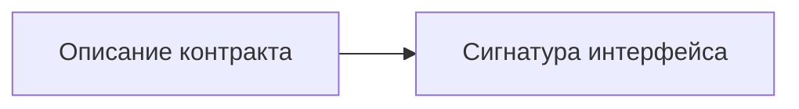
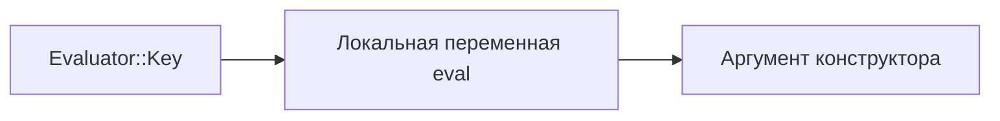

# Партия 10: 100 новых репозиториев

Репозитории 901–1000 из списка [targets.json](../../../datasets/diverse/2026-11-15/targets.json). Разбор выполнен по закреплённым исходникам; приложения не запускались.

## 1. Документация интерфейса Go

**FP — ложное срабатывание.** Правило: `commented-code`.

Исходник: [transferia/transferia — pkg/abstract/storage.go:366](https://github.com/transferia/transferia/blob/108b28638e9417ecee6f8e41c48a5f37a4d5126e/pkg/abstract/storage.go#L366). SHA: `108b28638e9417ecee6f8e41c48a5f37a4d5126e`.

### Что происходит

Комментарий объясняет, какой worker использует ShardingContext и какое поле заполняет метод. Сразу за ним находится активная сигнатура.

### Что можно утверждать

FP commented-code: это описание контракта, а не старая реализация. Точки с запятой в прозе не превращают её в программу.

### Что с этим делать

Сохранять документацию; для правила учитывать синтаксис языка и завершённость инструкций.

## 2. Переменная eval не вызывает eval

**FP — ложное срабатывание.** Правило: `insecure-eval-dynamic`.

Исходник: [dry-rb/dry-logic — lib/dry/logic/operations/key.rb:16](https://github.com/dry-rb/dry-logic/blob/b83ba7131132cbcf12007cb6ea4c0c083526395c/lib/dry/logic/operations/key.rb#L16). SHA: `b83ba7131132cbcf12007cb6ea4c0c083526395c`.

### Что происходит

Метод создаёт Evaluator::Key, присваивает объект локальной переменной eval и передаёт его конструктору.

### Что можно утверждать

FP выполнения строки как Ruby-кода: в этой строке есть присваивание, а не вызов Kernel.eval.

### Что с этим делать

Различать идентификатор и вызов функции. Для понятности переменную можно назвать key_evaluator; это не исправление подтверждённой RCE.

