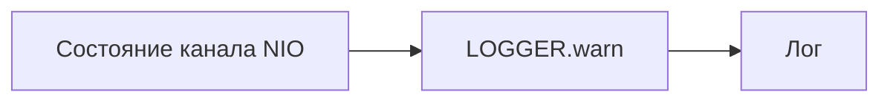
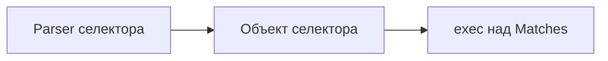

# Партия 11: 100 новых репозиториев

Репозитории 1001–1100 из списка [targets.json](../../../datasets/diverse/2026-11-15/targets.json). Разбор выполнен по закреплённым исходникам; приложения не запускались.

## 1. select в сетевом цикле — не SELECT базы

**FP — ложное срабатывание.** Правило: `insecure-sql-interpolated`.

Исходник: [vesoft-inc/nebula-java — client/src/main/fbthrift/com/facebook/thrift/server/TNonblockingServer.java:454](https://github.com/vesoft-inc/nebula-java/blob/cb5c6ac033a195982cea172d8703196ff4b05a0d/client/src/main/fbthrift/com/facebook/thrift/server/TNonblockingServer.java#L454). SHA: `cb5c6ac033a195982cea172d8703196ff4b05a0d`.

### Что происходит

Сервер проверяет, готов ли сетевой канал к чтению или записи. Для неожиданного состояния пишет LOGGER.warn.

### Что можно утверждать

FP SQL-инъекции: строка описывает состояние сетевого selector, не отправляет запрос в СУБД.

### Что с этим делать

Прежде чем искать SQLi, установить реальный API-приёмник строки. Слово select встречается в разных предметных областях.

## 2. Метод exec у селектора AST

**FP — ложное срабатывание.** Правило: `insecure-exec-interpolated`.

Исходник: [mck89/peast — lib/Peast/Query.php:62](https://github.com/mck89/peast/blob/e6c41a0632434fe9f63122cac5a79effc17137aa/lib/Peast/Query.php#L62). SHA: `e6c41a0632434fe9f63122cac5a79effc17137aa`.

### Что происходит

Parser разбирает селектор, затем его объект вызывает метод exec для набора найденных узлов.

### Что можно утверждать

FP командной инъекции в указанном вызове: получатель — объект селектора, а аргумент — набор AST-узлов. Это не глобальная PHP-функция exec.

### Что с этим делать

Правило должно различать глобальную функцию и метод объекта. При сомнении проследить тип получателя и реализацию метода.

