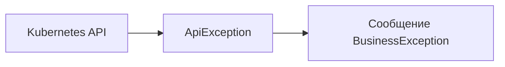
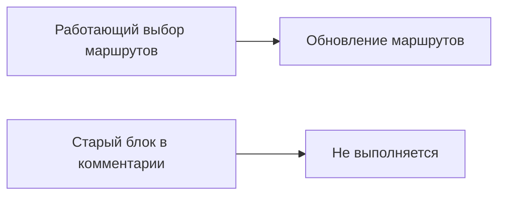

# Партия 12: 100 новых репозиториев

Репозитории 1101–1200 из списка [targets.json](../../../datasets/diverse/2026-11-15/targets.json). Разбор выполнен по закреплённым исходникам; приложения не запускались.

## 1. update ConfigMap и SQL UPDATE — разные операции

**FP — ложное срабатывание.** Правило: `insecure-sql-interpolated`.

Исходник: [higress-group/higress-console — backend/console/src/main/java/com/alibaba/higress/console/service/KubernetesLoginAttemptStore.java:112](https://github.com/higress-group/higress-console/blob/b3e541b3b22e6d44817fc33e66fd5a2953960304/backend/console/src/main/java/com/alibaba/higress/console/service/KubernetesLoginAttemptStore.java#L112). SHA: `b3e541b3b22e6d44817fc33e66fd5a2953960304`.

### Что происходит

Код вызывает Kubernetes API для ConfigMap. При ошибке создаёт BusinessException с названием ресурса в сообщении.

### Что можно утверждать

FP SQLi в этом месте: интерполяция попадает в текст исключения. Доступ к Kubernetes API — отдельная граница доверия.

### При каких других условиях возник бы риск

В другой реализации цепочка риска выглядела бы так: браузер → HTTP-параметр → включение значения в структуру SQL на сервере → выполнение изменённого запроса базой. Нужны и внешний источник, и настоящий SQL-приёмник; параметризованные значения должны оставаться данными.

Это учебное изменение условий, а не дополнительная находка в этом репозитории.

### Что с этим делать

Учитывать вызываемый API и назначение аргумента. Не считать любую строку со словом update SQL-запросом.

## 2. Старый вариант выбора маршрутов оставлен рядом с новым

**TP — подтверждённый сигнал сопровождения кода.** Правило: `commented-code`.

Исходник: [higress-group/higress-console — backend/sdk/src/main/java/com/alibaba/higress/sdk/service/DomainServiceImpl.java:160](https://github.com/higress-group/higress-console/blob/b3e541b3b22e6d44817fc33e66fd5a2953960304/backend/sdk/src/main/java/com/alibaba/higress/sdk/service/DomainServiceImpl.java#L160). SHA: `b3e541b3b22e6d44817fc33e66fd5a2953960304`.

### Что происходит

Метод активно выбирает маршруты для домена. Ниже сохранён закомментированный альтернативный блок под TODO переключения логики.

### Что можно утверждать

TP сопровождения кода: это полноценные выключенные инструкции. Разбор не устанавливает ошибку авторизации или маршрутизации.

### Что с этим делать

Завершить миграцию либо оформить отдельную задачу и убрать неисполняемый вариант из основного метода.

