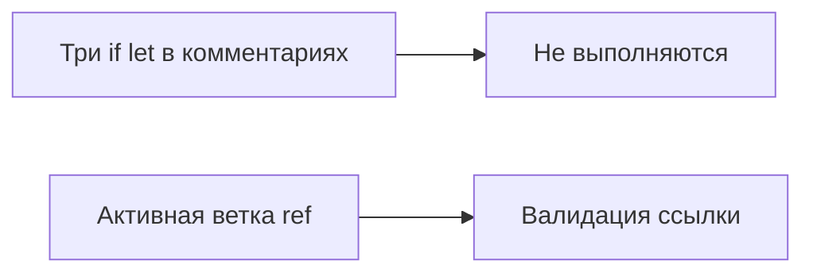

# Партия 13: 100 новых репозиториев

Репозитории 1201–1300 из списка [targets.json](../../../datasets/diverse/2026-11-15/targets.json). Разбор выполнен по закреплённым исходникам; приложения не запускались.

## 1. Swift: выключенные ветки if let

**TP — подтверждённый сигнал сопровождения кода.** Правило: `commented-code`.

Исходник: [objecthub/swift-dynamicjson — Sources/DynamicJSON/JSONSchema/JSONSchemaDraft2020.swift:252](https://github.com/objecthub/swift-dynamicjson/blob/2a850f5b33d847e5244c2eeb180de91d8fafe100/Sources/DynamicJSON/JSONSchema/JSONSchemaDraft2020.swift#L252). SHA: `2a850f5b33d847e5244c2eeb180de91d8fafe100`.

### Что происходит

В validateCore три if let оставлены комментариями, после них выполняется рабочая проверка descriptor.ref.

### Что можно утверждать

TP выключенного кода. Пустые тела не доказывают дефект JSON Schema-валидации: нужны требования к vocabulary и тесты, которых этот сигнал не устанавливает.

### Что с этим делать

Убрать черновые ветки либо реализовать требуемое поведение с тестами на конкретные ключевые слова схемы.

## 2. Формулы в криптографическом коде

**FP — ложное срабатывание.** Правило: `commented-code`.

Исходник: [arkworks-rs/r1cs-std — src/boolean/allocated.rs:82](https://github.com/arkworks-rs/r1cs-std/blob/45e4e2697626a9f9481fe57e70ed29c687194102/src/boolean/allocated.rs#L82). SHA: `45e4e2697626a9f9481fe57e70ed29c687194102`.

### Что происходит

Комментарий шаг за шагом преобразует логическое XOR в алгебраическое ограничение. Ниже вызывается enforce_r1cs_constraint.

### Что можно утверждать

FP commented-code: математическое объяснение поддерживает проверку реализации и не является отключённой Rust-программой.

### Что с этим делать

Сохранять вывод формулы. Учитывать математическую запись и соседний активный код вместо удаления по операторам.

