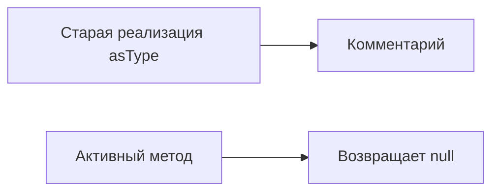
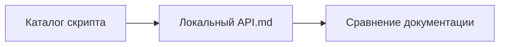

# Партия 14: 100 новых репозиториев

Репозитории 1301–1400 из списка [targets.json](../../../datasets/diverse/2026-11-15/targets.json). Разбор выполнен по закреплённым исходникам; приложения не запускались.

## 1. Тестовый helper хранит выключенную реализацию

**FP — ложное срабатывание.** Правило: `commented-code`.

Исходник: [unitsofmeasurement/unit-api — src/test/java/javax/measure/test/TestUnit.java:83](https://github.com/unitsofmeasurement/unit-api/blob/738b56aac94879d6b6665396eb445af2f823459a/src/test/java/javax/measure/test/TestUnit.java#L83). SHA: `738b56aac94879d6b6665396eb445af2f823459a`.

### Что происходит

В asType закомментированы поиск единицы измерения, проверка совместимости и исключение. Активный метод возвращает null.

### Что можно утверждать

FP по критерию рутины: TestUnit является тестовой заглушкой, а не реализацией рабочего продукта. Закомментированный вариант не устанавливает полезную находку для этого скана.

### Что с этим делать

Если helper намеренно минимален, удалить старую реализацию. Если поведение требуется тестам, вернуть его явно и проверить результат.

## 2. file_get_contents читает документацию

**FP — ложное срабатывание.** Правило: `insecure-ssrf`.

Исходник: [centrifugal/phpcent — gen/api_docs.php:292](https://github.com/centrifugal/phpcent/blob/a0e9172ec33d3b679488c7bc68fecb22a92f82a6/gen/api_docs.php#L292). SHA: `a0e9172ec33d3b679488c7bc68fecb22a92f82a6`.

### Что происходит

Генератор документации сравнивает новый текст с локальным API.md в режиме --check. ROOT задан через каталог самого скрипта.

Дополнительно проверено: [исходник](https://github.com/centrifugal/phpcent/blob/a0e9172ec33d3b679488c7bc68fecb22a92f82a6/gen/api_docs.php#L20)

### Что можно утверждать

FP SSRF: у пути в этой строке нет источника внешнего URL. Подмена локального checkout относится к другой модели доверия.

### При каких других условиях возник бы риск

Для SSRF нужна другая цепочка: недоверенный URL → сетевой запрос сервера → адрес, к которому пользователь не должен обращаться через этот сервер. Важны источник адреса, разрешённые схемы, перенаправления, DNS и сетевые ограничения. Локальное чтение или запись файла не доказывает такой запрос.

Это учебное изменение условий, а не дополнительная находка в этом репозитории.

### Что с этим делать

Проследить происхождение пути и режим работы скрипта. Имя функции допускает URL, но это ещё не означает серверный запрос по пользовательскому адресу.

