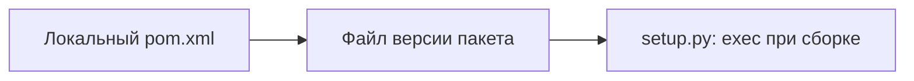

# Партия 15: 100 новых репозиториев

Репозитории 1401–1500 из списка [targets.json](../../../datasets/diverse/2026-11-15/targets.json). Разбор выполнен по закреплённым исходникам; приложения не запускались.

## 1. Select в заголовке Android-диалога

**FP — ложное срабатывание.** Правило: `insecure-sql-interpolated`.

Исходник: [WorldWindEarth/WorldWindKotlin — worldwind-examples-android/src/main/kotlin/earth/worldwind/examples/PlacemarksSelectDragActivity.kt:121](https://github.com/WorldWindEarth/WorldWindKotlin/blob/720ad2aebcd46dca2b2f7724b944b72e1d59c5db/worldwind-examples-android/src/main/kotlin/earth/worldwind/examples/PlacemarksSelectDragActivity.kt#L121). SHA: `720ad2aebcd46dca2b2f7724b944b72e1d59c5db`.

### Что происходит

Приложение строит заголовок выбора типа объекта, кладёт его в Bundle и передаёт VehicleTypeDialog.

### Что можно утверждать

FP SQL-инъекции в этой строке: строка используется интерфейсом. Само слово Select не является SQL-приёмником.

### Что с этим делать

Сначала установить назначение строки. Для SQLi необходим путь данных к выполнению запроса в базе.

## 2. exec при сборке пакета: граница доверия исходникам

**FP — ложное срабатывание.** Правило: `insecure-py-eval-exec`.

Исходник: [apache/flink-connector-kafka — flink-python/setup.py:60](https://github.com/apache/flink-connector-kafka/blob/634f2f49fcb0d520f6d1b94b21387cc7a9439abf/flink-python/setup.py#L60). SHA: `634f2f49fcb0d520f6d1b94b21387cc7a9439abf`.

### Что происходит

setup.py читает kafka_connector_version.py из фиксированного подкаталога пакета. Тот же скрипт генерирует этот файл из pom.xml для сборки.

Дополнительно проверено: [исходник](https://github.com/apache/flink-connector-kafka/blob/634f2f49fcb0d520f6d1b94b21387cc7a9439abf/flink-python/setup.py#L31)

### Что можно утверждать

FP заявленной инъекции из пользовательского ввода в этом месте. exec действительно выполняет Python, но вход — локальный код сборки; компрометация исходников пакета является отдельным сценарием.

### Что с этим делать

Можно хранить версию как данные вместо exec. При проверке различать доверенные исходники сборки и значения из сетевого запроса.

