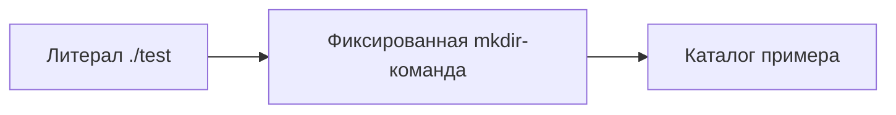
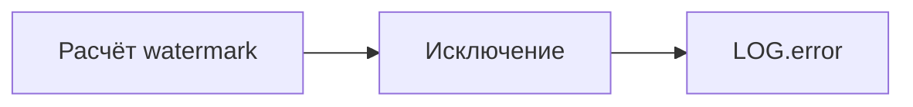

# Партия 16: 100 новых репозиториев

Репозитории 1501–1600 из списка [targets.json](../../../datasets/diverse/2026-11-15/targets.json). Разбор выполнен по закреплённым исходникам; приложения не запускались.

## 1. Форматирование строки с константой

**FP — ложное срабатывание.** Правило: `insecure-py-os-system`.

Исходник: [ImperialCollegeLondon/sharpy — sharpy/cases/templates/Ttail.py:709](https://github.com/ImperialCollegeLondon/sharpy/blob/7c9883e3719ff8f6905396a0ae1da765ce96b899/sharpy/cases/templates/Ttail.py#L709). SHA: `7c9883e3719ff8f6905396a0ae1da765ce96b899`.

### Что происходит

Пример научного расчёта создаёт каталог ./test через os.system. Подставляемое значение — строковый литерал, а не аргумент пользователя.

### Что можно утверждать

FP командной инъекции для этого выражения. Shell используется, но изменение команды внешними данными не показано.

### При каких других условиях возник бы риск

Риск возник бы, если бы подставляемая часть команды зависела от недоверенного ввода и оболочка интерпретировала её как синтаксис команды. В показанном выражении подстановка является фиксированным литералом; это другое условие.

Это учебное изменение условий, а не дополнительная находка в этом репозитории.

### Что с этим делать

os.makedirs("./test", exist_ok=True) выражает цель без shell. Отдельно оценивать динамические пути в других местах.

## 2. update в диагностике очереди сообщений

**FP — ложное срабатывание.** Правило: `insecure-sql-interpolated`.

Исходник: [WeBankFinTech/DeFiBus — defibus-broker/src/main/java/com/webank/defibus/broker/consumequeue/ConsumeQueueManager.java:155](https://github.com/WeBankFinTech/DeFiBus/blob/b4b5f79deb77eb38aeea6fc30ed356d5075b9507/defibus-broker/src/main/java/com/webank/defibus/broker/consumequeue/ConsumeQueueManager.java#L155). SHA: `b4b5f79deb77eb38aeea6fc30ed356d5075b9507`.

### Что происходит

При ошибке обновления watermark очереди обработчик пишет объект topic/queue в LOG.error.

### Что можно утверждать

FP SQLi: строка предназначена журналу. Другая логика работы очереди данным вердиктом не оценивается.

### При каких других условиях возник бы риск

В другой реализации цепочка риска выглядела бы так: браузер → HTTP-параметр → включение значения в структуру SQL на сервере → выполнение изменённого запроса базой. Нужны и внешний источник, и настоящий SQL-приёмник; параметризованные значения должны оставаться данными.

Это учебное изменение условий, а не дополнительная находка в этом репозитории.

### Что с этим делать

Искать реальные SQL-приёмники и путь внешнего ввода к структуре запроса, а не только ключевое слово.

