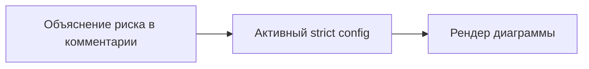
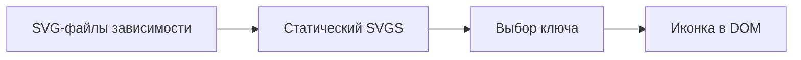

# Партия 17: 100 новых репозиториев

Репозитории 1601–1700 из списка [targets.json](../../../datasets/diverse/2026-11-15/targets.json). Разбор выполнен по закреплённым исходникам; приложения не запускались.

## 1. Комментарий о небезопасном режиме не включает его

**FP — ложное срабатывание.** Правило: `insecure-eval-dynamic`.

Исходник: [koedame/rails-mermaid_erd — lib/templates/index.html.erb:1659](https://github.com/koedame/rails-mermaid_erd/blob/1cc8fdd996e5587e952242538536e44465df79e3/lib/templates/index.html.erb#L1659). SHA: `1cc8fdd996e5587e952242538536e44465df79e3`.

### Что происходит

Комментарий объясняет причину strict-настройки Mermaid. Активный initialize задаёт securityLevel strict и выключает HTML labels.

### Что можно утверждать

FP eval: указанная строка не исполняется. Наличие защитных настроек не доказывает безопасность всего шаблона и всех версий Mermaid.

### Что с этим делать

Игнорировать текст комментариев при поиске вызова eval. Затем отдельно оценивать фактически включённые режимы рендеринга.

## 2. dangerouslySetInnerHTML со статической иконкой

**FP — ложное срабатывание.** Правило: `insecure-react-dangerous-html`.

Исходник: [miskin-lee/EdgeTerm — src/components/icons.tsx:123](https://github.com/miskin-lee/EdgeTerm/blob/83fd05929fdcb9c1fb2e29c9beb82af47f4f6e4b/src/components/icons.tsx#L123). SHA: `83fd05929fdcb9c1fb2e29c9beb82af47f4f6e4b`.

### Что происходит

Icon выбирает SVG по ключу из локального SVGS. Все значения словаря импортированы из файлов пакета codicons на этапе сборки.

Дополнительно проверено: [исходник](https://github.com/miskin-lee/EdgeTerm/blob/83fd05929fdcb9c1fb2e29c9beb82af47f4f6e4b/src/components/icons.tsx#L7)

### Что можно утверждать

FP XSS по указанному пути. Выбор имени меняет иконку, но не формирует произвольный HTML. Доверие к зависимостям остаётся отдельным вопросом.

### Что с этим делать

Для HTML-приёмника проверять происхождение самой строки. Пользовательский HTML нуждается в очистке; фиксированные ресурсы сборки имеют другую границу доверия.

