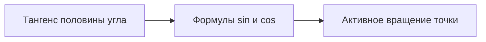
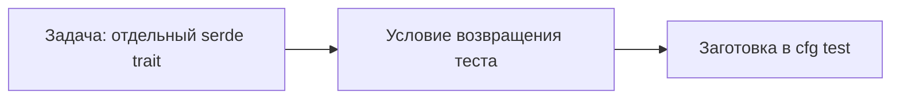

# Партия 19: 100 новых репозиториев

Репозитории 1801–1900 из списка [targets.json](../../../datasets/diverse/2026-11-15/targets.json). Разбор выполнен по закреплённым исходникам; приложения не запускались.

## 1. Формулы поворота рядом с реализацией

**FP — ложное срабатывание.** Правило: `commented-code`.

Исходник: [blendogames/SkinDeep — cm/CollisionModel_rotate.cpp:71](https://github.com/blendogames/SkinDeep/blob/04840ea158128d2e33f4bc95af825604d4a53c59/cm/CollisionModel_rotate.cpp#L71). SHA: `04840ea158128d2e33f4bc95af825604d4a53c59`.

### Что происходит

CM_RotatePoint получает tanHalfAngle. Комментарий напоминает формулы синуса и косинуса, а активные строки ниже вычисляют s и c по этим формулам.

### Что можно утверждать

FP commented-code. Запись sin(a) = ... является математическим равенством; это не старая C++-инструкция, которую нужно удалить.

### Что с этим делать

Сохранять пояснения алгоритма. Для правила нужны синтаксические признаки инструкций с учётом языка и контекста.

## 2. Выключенный тест с причиной и задачей

**FP — ложное срабатывание.** Правило: `commented-code`.

Исходник: [peeriot/myrmic — swarm/sorg-common/src/serde.rs:55](https://github.com/peeriot/myrmic/blob/452b40a0ed0221db78e2d45c690bd995d561e092/swarm/sorg-common/src/serde.rs#L55). SHA: `452b40a0ed0221db78e2d45c690bd995d561e092`.

### Что происходит

В cfg(test) оставлен тест проверки типов десериализации. FIXME ссылается на задачу и прямо говорит включить тест после выделения отдельного serde trait.

### Что можно утверждать

FP по критерию рутины: тестовая заготовка с явной причиной не считается автоматически полезной находкой очистки. Проблема проверки типов этим сканом не подтверждается.

### Что с этим делать

Следить за связанной задачей и возвращать проверку при выполнении её условий. Не удалять объяснение только ради уменьшения числа комментариев.

