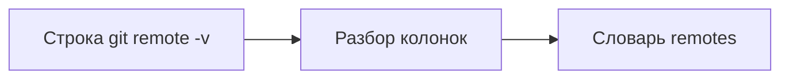
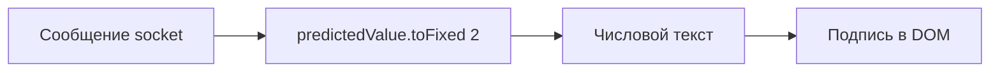

# Партия 20: 100 новых репозиториев

Репозитории 1901–2000 из списка [targets.json](../../../datasets/diverse/2026-11-15/targets.json). Разбор выполнен по закреплённым исходникам; приложения не запускались.

## 1. Номера колонок — пояснение формата данных

**FP — ложное срабатывание.** Правило: `commented-code`.

Исходник: [pluginsGLPI/formcreator — RoboFile.php:642](https://github.com/pluginsGLPI/formcreator/blob/bc1061a176b8260c766447440591da7f78ee54b6/RoboFile.php#L642). SHA: `bc1061a176b8260c766447440591da7f78ee54b6`.

### Что происходит

getRemotes разбирает строку git remote -v. Комментарий перечисляет смысл элементов массива: имя, URL и тип fetch/push.

### Что можно утверждать

FP commented-code: 0 = name является условным описанием позиции поля, не PHP-присваиванием. Другие exec в сборочном скрипте этим вердиктом не оцениваются.

### Что с этим делать

Сохранить пояснение формата. Правило должно отличать таблицу полей от синтаксиса выключенной программы.

## 2. В HTML подставляется результат форматирования числа

**FP — ложное срабатывание.** Правило: `insecure-innerhtml-dynamic`.

Исходник: [Raccoon254/Aviator-Automated-Betika-Bot — public/script.js:139](https://github.com/Raccoon254/Aviator-Automated-Betika-Bot/blob/a50e79407a1f7eda1b7df4ec61083c60b5d7f210/public/script.js#L139). SHA: `a50e79407a1f7eda1b7df4ec61083c60b5d7f210`.

### Что происходит

Обработчик сообщения socket берёт predictedValue и вызывает toFixed(2), затем добавляет результат к фиксированной подписи.

### Что можно утверждать

FP XSS для этой подстановки: числовое форматирование не выпускает произвольные HTML-теги. Некорректный тип может вызвать ошибку — это отдельный вопрос обработки данных. Другие места вывода таблицы требуют самостоятельной проверки.

### Что с этим делать

Для текстовой подписи использовать textContent и валидировать тип числа. При анализе XSS проверять преобразование непосредственно перед HTML-приёмником.

