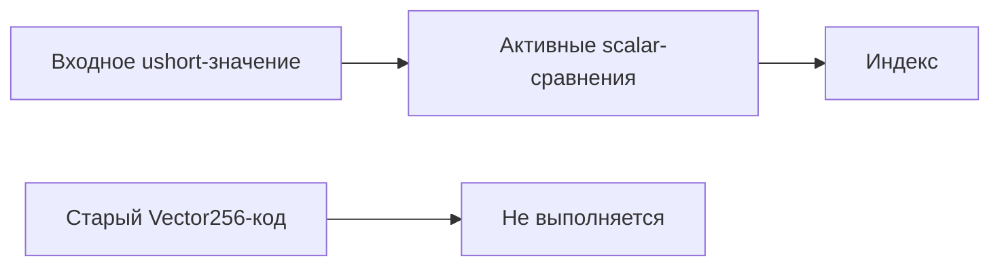
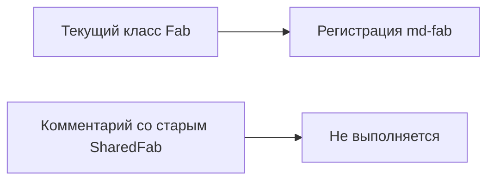

# Партия 21: 100 новых репозиториев

Репозитории 2001–2100 из списка [targets.json](../../../datasets/diverse/2026-11-15/targets.json). Разбор выполнен по закреплённым исходникам; приложения не запускались.

## 1. Старая SIMD-реализация рядом с рабочей

**TP — подтверждённый сигнал сопровождения кода.** Правило: `commented-code`.

Исходник: [itsBuggingMe/Frent — Frent/Collections/ArchetypeNeighborCache.cs:21](https://github.com/itsBuggingMe/Frent/blob/88e388ad3de7b2d7f5add30d97136d7db94b5732/Frent/Collections/ArchetypeNeighborCache.cs#L21). SHA: `88e388ad3de7b2d7f5add30d97136d7db94b5732`.

### Что происходит

Traverse сравнивает значение с несколькими полями обычными if. Над ним сохранён выключенный Vector256-вариант с отрицательной авторской оценкой и TODO улучшения.

### Что можно утверждать

TP сопровождения кода. Этот сигнал не устанавливает ошибку индекса, память-порчу или уязвимость текущего алгоритма.

### Что с этим делать

Удалить прежний прототип из рабочего метода; дальнейшую оптимизацию проверять отдельными тестами и измерениями. Старый вариант доступен в Git.

## 2. Старый setup-блок после реализации компонента

**TP — подтверждённый сигнал сопровождения кода.** Правило: `commented-code`.

Исходник: [material-esm/material — buttons/fab.js:831](https://github.com/material-esm/material/blob/81145b08490429ad6070c0ad4179e8e39e5f9576/buttons/fab.js#L831). SHA: `81145b08490429ad6070c0ad4179e8e39e5f9576`.

### Что происходит

Файл определяет Fab и регистрирует md-fab. Между ними остался закомментированный IIFE с SharedFab и requestUpdateOnAriaChange; этих имён в активных определениях и импортах файла нет.

Дополнительно проверено: [исходник](https://github.com/material-esm/material/blob/81145b08490429ad6070c0ad4179e8e39e5f9576/buttons/fab.js#L1), [исходник](https://github.com/material-esm/material/blob/81145b08490429ad6070c0ad4179e8e39e5f9576/buttons/fab.js#L36)

### Что можно утверждать

TP выключенного кода сопровождения. Само отсутствие активного helper не доказывает проблему доступности компонента: для этого нужны требования и отдельные UI-тесты.

### Что с этим делать

Убрать остаток старой реализации. Если требуется поведение ARIA, реализовать и проверить его для текущего Fab, а не просто раскомментировать старый блок.

