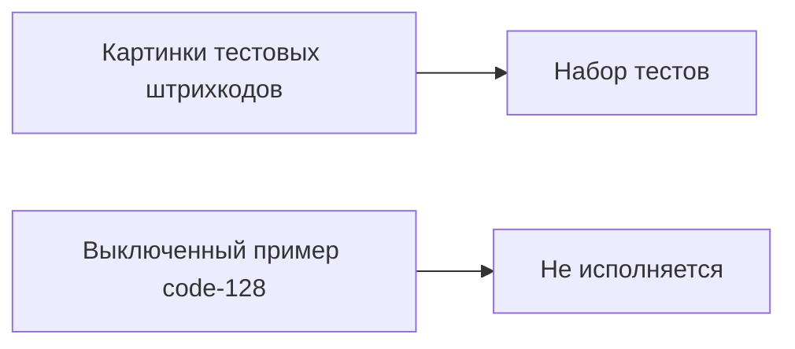
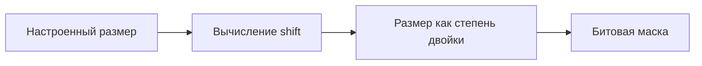

# Партия 22: 100 новых репозиториев

Репозитории 2101–2200 из списка [targets.json](../../../datasets/diverse/2026-11-15/targets.json). Разбор выполнен по закреплённым исходникам; приложения не запускались.

## 1. Выключенный пример распознавания штрихкода в тестах

**FP — ложное срабатывание.** Правило: `commented-code`.

Исходник: [mubaidr/Javascript-Barcode-Reader — test/index.test.js:205](https://github.com/mubaidr/Javascript-Barcode-Reader/blob/fb3122adac217dc1c1b0e75968251125998b8407/test/index.test.js#L205). SHA: `fb3122adac217dc1c1b0e75968251125998b8407`.

### Что происходит

Файл содержит тесты чтения картинок разных форматов. Два примера code-128 оставлены комментариями между активными тестами.

### Что можно утверждать

FP по критерию рутины для тестовых fixtures. Само наличие выключенного примера не доказывает проблему рабочего декодера или безопасность обработки изображения.

### Что с этим делать

Оценивать покрытие тестов отдельно и править исходный тестовый сценарий, если это требуется. Не выдавать тестовый фрагмент за уязвимость библиотеки.

## 2. Таблица округления размера региона

**FP — ложное срабатывание.** Правило: `commented-code`.

Исходник: [MultiPaper/ShreddedPaper — shreddedpaper-server/src/main/java/io/multipaper/shreddedpaper/region/RegionPos.java:24](https://github.com/MultiPaper/ShreddedPaper/blob/408a2489b30c13a94cd7c4d5ca9302a402d68e8b/shreddedpaper-server/src/main/java/io/multipaper/shreddedpaper/region/RegionPos.java#L24). SHA: `408a2489b30c13a94cd7c4d5ca9302a402d68e8b`.

### Что происходит

Инициализатор вычисляет степень двойки, сдвиг и маску. Комментарий показывает ожидаемые результаты для размеров 7, 8 и 9.

### Что можно утверждать

FP commented-code: стрелки и наборы значений являются примерами к алгоритму. Они помогают понять переход от настройки к маске.

### Что с этим делать

Сохранить примеры. Дополнительная польза — проверять эти границы тестами, а не удалять объяснение по совпадению знаков.

