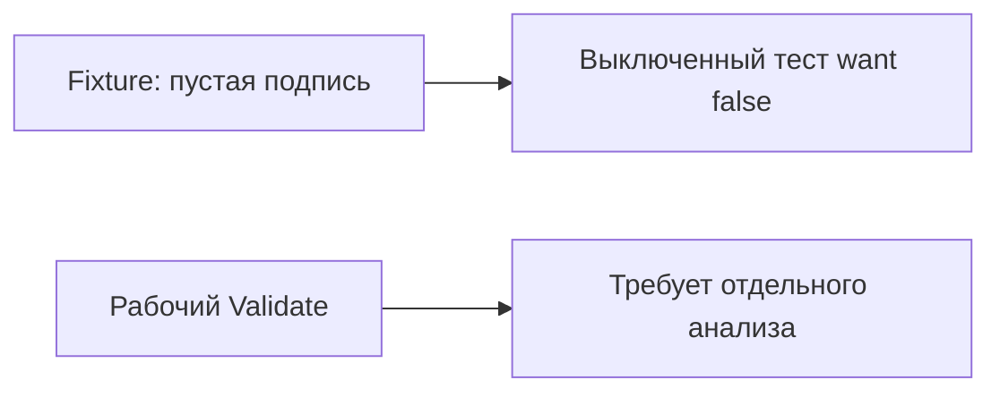
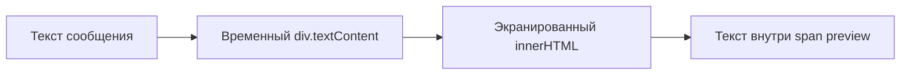

# Партия 23: 100 новых репозиториев

Репозитории 2201–2300 из списка [targets.json](../../../datasets/diverse/2026-11-15/targets.json). Разбор выполнен по закреплённым исходникам; приложения не запускались.

## 1. Тест входного webhook — не сама проверка webhook

**FP — ложное срабатывание.** Правило: `commented-code`.

Исходник: [stakater/GitWebhookProxy — pkg/providers/github_test.go:103](https://github.com/stakater/GitWebhookProxy/blob/35f1b2d461ec5c4526634caa52c8591257c7ce58/pkg/providers/github_test.go#L103). SHA: `35f1b2d461ec5c4526634caa52c8591257c7ce58`.

### Что происходит

В массиве тестов закомментирован сценарий пустой подписи с want=false. Это описание тестового входа и ожидаемого результата.

### Что можно утверждать

FP commented-code по критерию рутины. Выключенный тест не доказывает, что рабочий обработчик принимает webhook без проверки подписи.

### Что с этим делать

Для оценки безопасности отдельно читать реализацию Validate и маршруты вызова. Тестовый пробел оформлять как задачу покрытия, а не как доказанную уязвимость сервиса.

## 2. Проверяем реализацию esc перед выводом HTML

**FP — ложное срабатывание.** Правило: `insecure-innerhtml-dynamic`.

Исходник: [calendar0917/DeepseekWeb-enhance — ds-enhance.user.js:950](https://github.com/calendar0917/DeepseekWeb-enhance/blob/7ba15833610bbd12f0c582dd154e31771ea09d90/ds-enhance.user.js#L950). SHA: `7ba15833610bbd12f0c582dd154e31771ea09d90`.

### Что происходит

Предпросмотр берёт текст сообщения, обрезает его и вызывает esc. Проверенный helper помещает строку в textContent временного div, затем читает экранированный innerHTML. Номер строки берётся из индекса цикла.

Дополнительно проверено: [исходник](https://github.com/calendar0917/DeepseekWeb-enhance/blob/7ba15833610bbd12f0c582dd154e31771ea09d90/ds-enhance.user.js#L410)

### Что можно утверждать

FP XSS в рассмотренной строке, несмотря на high сканера. Экранирование подходит именно для текста между тегами; такой helper нельзя безусловно переносить в URL, JavaScript или HTML-атрибут.

### При каких других условиях возник бы риск

Если бы непроверенный текст напрямую подставлялся в HTML, цепочка могла бы быть такой: внешний ввод → строка разметки → HTML-парсер браузера → действия в контексте страницы. Для риска нужны данные, способные изменить разметку, и отсутствие подходящего экранирования. В проверенной строке показанное преобразование разрывает именно этот путь.

Это учебное изменение условий, а не дополнительная находка в этом репозитории.

### Что с этим делать

Сохранять привязку очистки к контексту вставки. Для текстового интерфейса прямой textContent проще; сканеру нужно проследить преобразование esc, а не считать все данные сообщения неизменёнными.

