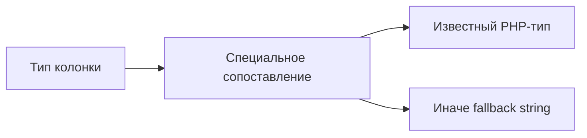
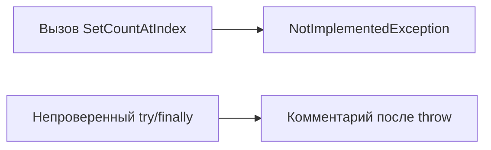

# Партия 24: 100 новых репозиториев

Репозитории 2301–2400 из списка [targets.json](../../../datasets/diverse/2026-11-15/targets.json). Разбор выполнен по закреплённым исходникам; приложения не запускались.

## 1. Список SQL-типов поясняет default-ветку

**FP — ложное срабатывание.** Правило: `commented-code`.

Исходник: [spatie/laravel-model-info — src/Attributes/AttributeFinder.php:121](https://github.com/spatie/laravel-model-info/blob/56a42bb2115726cc7c0beef9eadcab3fc4ec1582/src/Attributes/AttributeFinder.php#L121). SHA: `56a42bb2115726cc7c0beef9eadcab3fc4ec1582`.

### Что происходит

AttributeFinder явно сопоставляет некоторые типы с int, float, bool и другими PHP-типами. Комментарий перечисляет типы для string; активный return возвращает string, когда специальное сопоставление не найдено.

### Что можно утверждать

FP commented-code: список поясняет уже работающий fallback. Сам комментарий не доказывает отсутствия преобразования или SQL-инъекции.

### Что с этим делать

Сохранить понятное описание default-поведения или перенести его в документацию. При анализе учитывать итоговый return, а не только закомментированный фрагмент match.

## 2. Непроверенный прототип после активного исключения

**TP — подтверждённый сигнал сопровождения кода.** Правило: `commented-code`.

Исходник: [HdrHistogram/HdrHistogram.NET — HdrHistogram/IntConcurrentHistogram.cs:138](https://github.com/HdrHistogram/HdrHistogram.NET/blob/023f13c77134b6e15626f6eb8325a8b365f4d62e/HdrHistogram/IntConcurrentHistogram.cs#L138). SHA: `023f13c77134b6e15626f6eb8325a8b365f4d62e`.

### Что происходит

SetCountAtIndex явно выбрасывает NotImplementedException. Ниже сохранён закомментированный try/finally с блокировками и изменением двух массивов счётчиков.

### Что можно утверждать

TP сопровождения кода. По этому фрагменту нельзя утверждать, что рабочее приложение вызывает метод или имеет гонку данных: комментарий объясняет, что обычное декодирование использует другие реализации.

### Что с этим делать

Удалить устаревший прототип либо реализовать требуемый метод с тестами конкурентности. Не раскомментировать код вслепую только для устранения исключения.

