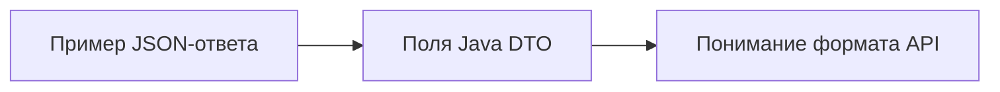
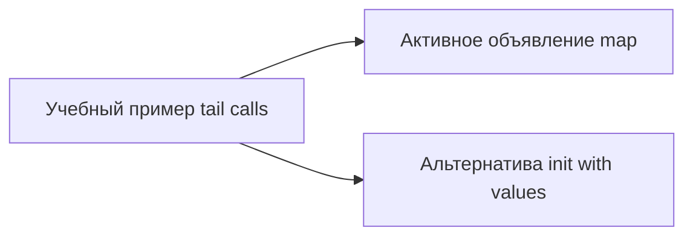

# Партия 25: 100 новых репозиториев

Репозитории 2401–2500 из списка [targets.json](../../../datasets/diverse/2026-11-15/targets.json). Разбор выполнен по закреплённым исходникам; приложения не запускались.

## 1. JSON-ответ рядом с Java-моделью

**FP — ложное срабатывание.** Правило: `commented-code`.

Исходник: [hkh1012/langboot — src/main/java/com/hkh/ai/chain/vectorizer/baidu/BaiduQianFanVectorizationResult.java:31](https://github.com/hkh1012/langboot/blob/03227e6b0216329d58e87ecf0de5edf649763cd1/src/main/java/com/hkh/ai/chain/vectorizer/baidu/BaiduQianFanVectorizationResult.java#L31). SHA: `03227e6b0216329d58e87ecf0de5edf649763cd1`.

### Что происходит

Класс описывает object, created, data и usage. Комментарий показывает пример ответа embedding API с массивом чисел и индексами элементов.

### Что можно утверждать

FP commented-code: структура JSON поясняет формат внешних данных. Наличие фигурных скобок и кавычек не делает пример выключенной Java-реализацией.

### Что с этим делать

Сохранить понятный пример схемы либо вынести его в документацию API. Правило должно учитывать язык и роль фрагмента.

## 2. Альтернативный способ инициализации в eBPF-примере

**FP — ложное срабатывание.** Правило: `commented-code`.

Исходник: [mozillazg/hello-libbpfgo — 22-tail-calls/main.bpf.c:33](https://github.com/mozillazg/hello-libbpfgo/blob/cb0cb68d0a748012f6b9587e7e6c950d351d5f7c/22-tail-calls/main.bpf.c#L33). SHA: `cb0cb68d0a748012f6b9587e7e6c950d351d5f7c`.

### Что происходит

Учебный пример объявляет BPF map для tail calls. Комментарий init with values показывает альтернативу с начальным значением массива программ. Назначение репозитория явно указано как набор примеров libbpfgo/cilium.

### Что можно утверждать

FP по критерию рутины для examples-кода. Закомментированный вариант здесь служит сравнением двух способов, а не доказывает дефект работающего сервиса.

### Что с этим делать

Сохранять или оформлять альтернативу как самостоятельный учебный пример. Не исключать любой eBPF-код: в реальном агенте отдельно проверяются входы, привилегии и работа в ядре.

