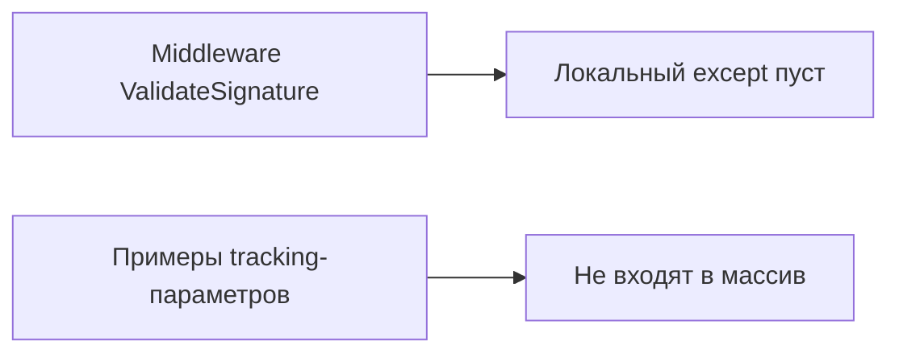
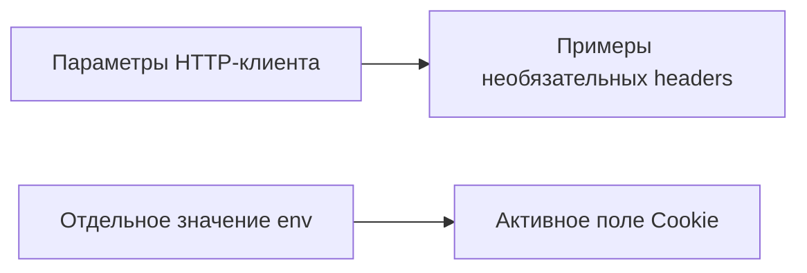

# Партия 26: 100 новых репозиториев

Репозитории 2501–2600 из списка [targets.json](../../../datasets/diverse/2026-11-15/targets.json). Разбор выполнен по закреплённым исходникам; приложения не запускались.

## 1. Примеры параметров в шаблоне Laravel middleware

**FP — ложное срабатывание.** Правило: `commented-code`.

Исходник: [frikishaan/tiny-crm — app/Http/Middleware/ValidateSignature.php:15](https://github.com/frikishaan/tiny-crm/blob/4d78908065cead042427322e53449c56f4bbc0b3/app/Http/Middleware/ValidateSignature.php#L15). SHA: `4d78908065cead042427322e53449c56f4bbc0b3`.

### Что происходит

Класс наследует ValidateSignature и показывает возможные имена tracking-параметров внутри $except. Все перечисленные элементы закомментированы, поэтому локальный массив исключений пуст.

### Что можно утверждать

FP commented-code по критерию конфигурационных шаблонов. Здесь не выключена сама проверка подписи. Глобальные настройки middleware и использование signed URL требуют отдельного анализа.

### Что с этим делать

Изменять исключения только по требованиям приложения. Нельзя выдавать список примеров за обход подписи или автоматически включать его ради удаления комментариев.

## 2. HTTP-заголовки как справочные настройки клиента

**FP — ложное срабатывание.** Правило: `commented-code`.

Исходник: [cat-kun/qinglong-scripts — csair_checkin.js:118](https://github.com/cat-kun/qinglong-scripts/blob/93b706d7154ecb4fb73d8aff4668208e448259f2/csair_checkin.js#L118). SHA: `93b706d7154ecb4fb73d8aff4668208e448259f2`.

### Что происходит

В объекте options оставлены примеры Connection, Accept-Encoding, User-Agent и Referer. Активная строка Cookie получает значение переменной окружения отдельно.

### Что можно утверждать

FP commented-code для справочного блока настроек. Наличие примеров заголовков не устанавливает ни обход аутентификации, ни утечку cookie; значение cookie не проверялось и запрос не выполнялся.

### Что с этим делать

Хранить примеры в понятном месте. Для оценки безопасности отдельно разбирать источник секретов и адресата запроса; User-Agent не является заменой аутентификации.

