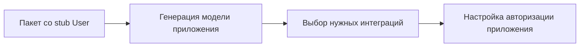
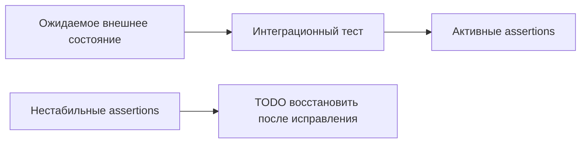

# Партия 27: 100 новых репозиториев

Репозитории 2601–2700 из списка [targets.json](../../../datasets/diverse/2026-11-15/targets.json). Разбор выполнен по закреплённым исходникам; приложения не запускались.

## 1. Необязательные интеграции в шаблоне User

**FP — ложное срабатывание.** Правило: `commented-code`.

Исходник: [stephenjude/filament-jetstream — stubs/app/Models/User.php:14](https://github.com/stephenjude/filament-jetstream/blob/34fa17c56f042e4de6ef31d6e772f2e6f52fd8db/stubs/app/Models/User.php#L14). SHA: `34fa17c56f042e4de6ef31d6e772f2e6f52fd8db`.

### Что происходит

Пакет публикует stub модели пользователя. В нём показаны необязательные импорты и traits для teams, tenants и API tokens; пользователь шаблона выбирает нужные возможности при интеграции.

### Что можно утверждать

FP commented-code для scaffolding-шаблона. Закомментированный use в шаблоне не доказывает обход аутентификации или отсутствие серверных разрешений в готовом приложении.

### Что с этим делать

Сохранять понятные варианты интеграции либо описывать их в документации. Для оценки реального приложения нужно смотреть его сгенерированную модель, middleware, policies и маршруты.

## 2. Flaky assertions в интеграционном тесте API

**FP — ложное срабатывание.** Правило: `commented-code`.

Исходник: [Uniswap/routing-api — test/mocha/integ/graphql/graphql-token-fee-fetcher.test.ts:75](https://github.com/Uniswap/routing-api/blob/f5a81893b812b6745b1f8b7fa3a55a714cb9d89b/test/mocha/integ/graphql/graphql-token-fee-fetcher.test.ts#L75). SHA: `f5a81893b812b6745b1f8b7fa3a55a714cb9d89b`.

### Что происходит

Тест сравнивает комиссии токенов через GraphQL/on-chain fetcher. Несколько проверок статусов выключены с явным TODO вернуть их после исправления нестабильности; другие assertions выполняются.

### Что можно утверждать

FP автоматической очистки комментариев по критерию рутины. Этот фрагмент не доказывает ошибку маршрутизации, потерю средств или уязвимость Uniswap. Запросы к API и блокчейну при разборе не выполнялись.

### Что с этим делать

Исследовать зависимость теста от внешнего состояния и вернуть устойчивые проверки. Без анализа рабочего пути нельзя переносить вывод о тесте на безопасность продукта.

