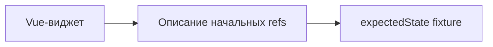
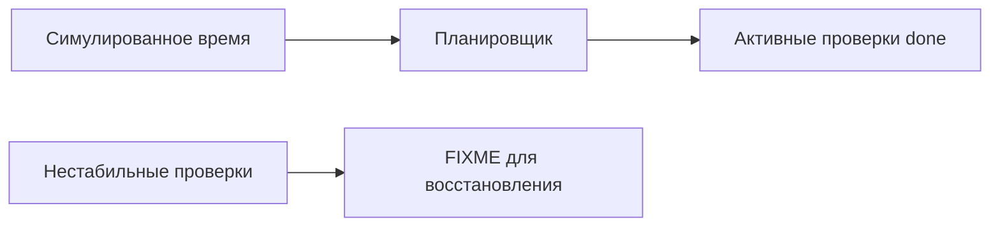

# Партия 28: 100 новых репозиториев

Репозитории 2701–2800 из списка [targets.json](../../../datasets/diverse/2026-11-15/targets.json). Разбор выполнен по закреплённым исходникам; приложения не запускались.

## 1. Снимок ожидаемого состояния Vue в комментарии

**FP — ложное срабатывание.** Правило: `commented-code`.

Исходник: [patchorbit/domscribe — packages/domscribe-test-fixtures/fixtures/_registry/vue/3/expectations.ts:198](https://github.com/patchorbit/domscribe/blob/d74d1939bc20483f66dabfb7295211f84c538dd3/packages/domscribe-test-fixtures/fixtures/_registry/vue/3/expectations.ts#L198). SHA: `d74d1939bc20483f66dabfb7295211f84c538dd3`.

### Что происходит

Fixture описывает виджет обработчиков событий. Комментарий перечисляет исходные refs, а ниже expectedState задаёт проверяемые значения clickCount, lastClickInfo и formSubmitted.

### Что можно утверждать

FP commented-code: перечисление состояния объясняет тестовый сценарий. Это не удалённая реализация обработчиков событий.

### Что с этим делать

Сохранять смысл комментария. Для правила различать краткую таблицу состояние/значение и последовательность выключенных инструкций.

## 2. Нестабильные проверки времени в тесте

**FP — ложное срабатывание.** Правило: `commented-code`.

Исходник: [SleipnirGroup/Choreo — choreolib/src/test/java/choreo/auto/DoneTest.java:86](https://github.com/SleipnirGroup/Choreo/blob/efe62084a35eb19feff04c696bcedffc22d84e9d/choreolib/src/test/java/choreo/auto/DoneTest.java#L86). SHA: `efe62084a35eb19feff04c696bcedffc22d84e9d`.

### Что происходит

Тест шагает симулированным временем. Часть assert выключена после FIXME о нестабильности в CI, а проверки конечного done остаются активны.

### Что можно утверждать

FP предложения очистить комментарии по критерию рутины. Здесь есть вопрос качества теста, но скан не устанавливает уязвимость и не доказывает, что правильное действие — удалить проверки.

### Что с этим делать

Разобраться с управлением временем и вернуть детерминированные проверки. Не уменьшать покрытие ради исчезновения предупреждения.

