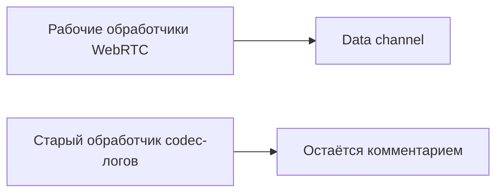
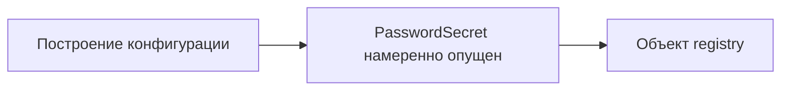

# Партия 29: 100 новых репозиториев

Репозитории 2801–2900 из списка [targets.json](../../../datasets/diverse/2026-11-15/targets.json). Разбор выполнен по закреплённым исходникам; приложения не запускались.

## 1. Выключенный обработчик диагностики WebRTC

**TP — подтверждённый сигнал сопровождения кода.** Правило: `commented-code`.

Исходник: [zhensherlock/webrtc-streamer-helper — src/core/webRTCStreamer.ts:246](https://github.com/zhensherlock/webrtc-streamer-helper/blob/bab9804d83fc5ced727890fa3b54d354b9eedd7b/src/core/webRTCStreamer.ts#L246). SHA: `bab9804d83fc5ced727890fa3b54d354b9eedd7b`.

### Что происходит

После установки работающих обработчиков datachannel оставлен закомментированный onicegatheringstatechange. Внутри он перебирает receivers и печатает codecs в консоль.

### Что можно утверждать

TP сопровождения кода: выключенная диагностическая реализация засоряет основной метод. Это не подтверждённая уязвимость WebRTC и не доказательство утечки через активный обработчик.

### Что с этим делать

Удалить старую диагностику либо оформить её как управляемое средство отладки с понятным назначением. История Git сохраняет предыдущий вариант.

## 2. Отсутствующее поле конфигурации показано намеренно

**FP — ложное срабатывание.** Правило: `commented-code`.

Исходник: [kubeflow/hub — clients/ui/bff/internal/api/model_registry_settings_handler.go:219](https://github.com/kubeflow/hub/blob/bc94c73536132db7d4d14e5cde5af57687b2ff81/clients/ui/bff/internal/api/model_registry_settings_handler.go#L219). SHA: `bc94c73536132db7d4d14e5cde5af57687b2ff81`.

### Что происходит

При построении конфигурации registry комментарий intentionally not set поясняет, почему блок PasswordSecret не включён в объект. Остальные поля заполняются активно.

### Что можно утверждать

FP автоматического предложения удалить этот блок: он служит пояснением намеренно опущенной настройки. Комментарий не доказывает ни утечку пароля, ни успешный вход в базу без пароля.

### Что с этим делать

Для оценки доступа к базе отдельно проследить итоговую конфигурацию, секреты, оператор и настройки сервера. Не выводить уязвимость только из закомментированного имени PasswordSecret.

