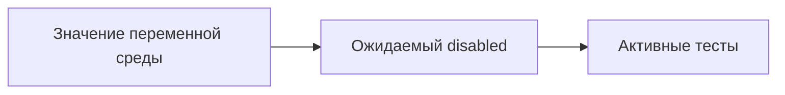
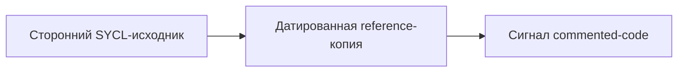

# Партия 30: 97 новых репозиториев

Репозитории 2901–2997 из списка [targets.json](../../../datasets/diverse/2026-11-15/targets.json). Разбор выполнен по закреплённым исходникам; приложения не запускались.

## 1. Таблица настроек в комментарии

**FP — ложное срабатывание.** Правило: `commented-code`.

Исходник: [toss/apps-in-toss-harness — packages/debugger/src/mcp/__tests__/devtools-opener.test.ts:164](https://github.com/toss/apps-in-toss-harness/blob/5972a1c044f720132709c702c77426dd02beb31f/packages/debugger/src/mcp/__tests__/devtools-opener.test.ts#L164). SHA: `5972a1c044f720132709c702c77426dd02beb31f`.

### Что происходит

Комментарий перед describe объясняет opt-in включение DevTools: только значение 1 разрешает автоматическое открытие окна; остальные варианты оставляют его выключенным.

### Что можно утверждать

FP commented-code: строки вида AIT_AUTO_DEVTOOLS=1 описывают входные значения теста и ожидаемый disabled, а не содержат выключенную реализацию.

### Что с этим делать

Не путать пары настройка/результат с инструкциями языка. Сохранять пояснение, которое помогает понять тесты.

## 2. Копия стороннего исходника в исследовательских материалах

**FP — ложное срабатывание.** Правило: `commented-code`.

Исходник: [SergiioB/intel-arc-pro-b70-inference-cookbook — research/b70-docs/research/references/quant-avail-20261009/master-sycl.cpp:3477](https://github.com/SergiioB/intel-arc-pro-b70-inference-cookbook/blob/21cd5a06908047641a0788e818d2401cd639814a/research/b70-docs/research/references/quant-avail-20261009/master-sycl.cpp#L3477). SHA: `21cd5a06908047641a0788e818d2401cd639814a`.

### Что происходит

Сканер увидел выключенный блок peer-access в master-sycl.cpp. Путь хранит датированную копию reference-кода; заголовок указывает Intel и LLVM.

Дополнительно проверено: [исходник](https://github.com/SergiioB/intel-arc-pro-b70-inference-cookbook/blob/21cd5a06908047641a0788e818d2401cd639814a/research/b70-docs/research/references/quant-avail-20261009/master-sycl.cpp#L1)

### Что можно утверждать

FP по критерию рутины: исследовательская копия стороннего исходника не является местом для автоматической очистки рабочего кода этого проекта. Наличие выключенных инструкций само по себе верно.

### Что с этим делать

Сначала установить владельца и назначение файла. Не подавлять весь каталог research без проверки: там может находиться и собственный исполняемый код.

